# Nominal Roll Integration & Staff Lifecycle — design

This release makes the HR **nominal roll** the source of the staff directory, and adds the
staff-lifecycle tools built on it: **promotions** (with cascade and rollback) and an
**advanced query** builder with saved queries. Everything is in the `staff` app.

| Page | URL | Permission |
|---|---|---|
| **Staff import & export** (Import · Export · Template · History) — Administration menu | `/staff/nominal-roll/` | `staff.import_nominal_roll` **or** `staff.export_nominal_roll` |
| Promotions | `/staff/promotions/` | `staff.promote_staff` |
| Promotion history (+ rollback) | `/staff/promotions/history/` | `staff.promote_staff` |
| Advanced query / saved queries | `/staff/query/`, `/staff/query/saved/` | `staff.view_staff` (export needs `staff.export_nominal_roll`, shared queries need `staff.manage_shared_queries`) |

Sidebar: **Administration → Staff import & export** (where Import / Export already lived; HR users
with the import or export permission see the Administration menu with just this item), and
**People → Promotions** and **People → Advanced query** (below *Leadership panel*). The old
*Administration → Import / Export → Staff directory* module now opens the same page — there is one
staff import/export. The staff detail page gains a **Nominal roll** facts card, the **Staff file**
timeline, an **Items held now** card, and **Promote** and **Transfer** buttons.

Related documents: `IMPORT_PLAYBOOK.md` (HR how-to), `PROMOTION_GUIDE.md`, `QUERY_COOKBOOK.md`,
`MIGRATIONS_ADDED.md`, `SETUP.md`, `FINAL_CHECKLIST.md`.

---

## 1. Field mapping (Excel → model)

Columns are matched **by header text** (case and punctuation ignored), never by position — except
for a sheet with no header row at all (NEW STAFF 2023), which is read in the standard order. A
damaged repeated header (the file has one with `129` typed over SURNAME, some with a blank or a date
over D_FAPPMT / D_BIRTH) keeps the previous header's column for that cell.

| Excel header | Staff field | Notes |
|---|---|---|
| S/NO | — | ignored; `e.g.` marks the template's example row (skipped) |
| SURNAME | `last_name` | whitespace collapsed, case kept |
| OTHER NAME | `first_name` | |
| SEX | `gender` | M / F (MALE / FEMALE accepted) |
| FILE NO | `employee_no` | the match key; `1413.0` → `1413`; a value with no digit (blank, `+`) is matched by name |
| ST_ORIGIN | `state_of_origin` → **StateOfOrigin** | spelling fixes, e.g. KAN0, AK/IBOM, C/ RIVER, ABUJA→FCT |
| LGA | `lga` | free text; 774-LGA autocomplete on the staff form |
| DESIGNATION | `designation` → **Designation** | matched on a normalised key (SNR./SN/SEN→SENIOR, PROG/PROGS→PROGRAMME, OFF/OFFR→OFFICER…) and on aliases |
| CONTEDISS/CONHESS | `grade_level` | `9`, `9.0`, `CONHES 06` → `6`; text in this column is ignored with a warning |
| DEPARTMT | `department` → **Department** | the column, or the section heading above the row when the column is blank/numeric; “ZONAL OFFICE” + a zonal heading → “ZONAL OFFICE AWKA” etc. |
| D_BIRTH | `date_of_birth` | also fills the legacy `birth_month`/`birth_day` when they are empty; implausible dates (age < 15 or born before 1930) are not stored |
| D_FAPPMT | `date_first_appointment` | |
| D_JBOARD | `date_joined_board` | |
| D_PRAPPMT | `date_present_appointment` | updated by every promotion |
| D_COF | `date_confirmation` | |
| REMARKS | `state` → **StaffState** | CONFIRMED/COMFIRMED → Confirmed, PROBATION → Probation, anything else created as written |
| QUALIFICATION (S) | `qualifications` | free text |

`birth_month` / `birth_day` are kept (legacy section of the admin, form field help says
“Deprecated — use date of birth”).

## 2. New models

| Model | Purpose |
|---|---|
| `StateOfOrigin` (Lookup) | 36 states + FCT, with `code` and geopolitical `zone`. |
| `Designation` | Post titles. `rank` (seniority), `contediss_min/max` (grade range, used to auto-fill the grade on promotion), `next_designation` (normal next step), `aliases` (other spellings, one per line), `is_active`, `sort_order`. |
| `Promotion` | One promotion or one rollback. From/to designation and grade, `from_present_appointment` (restored on rollback), effective date, reason, approver, `cascade_source` (root promotion of a cascade), `reverses` (set on a rollback entry). Written only by `staff/promotions.py`; read-only in the admin. |
| `ImportSession` | One confirmed import: file name, who, sheets, new/updated/skipped/error counts, warnings, status, mode, and the text report (restricted storage, downloaded through a permission-checked view). |
| `SavedQuery` | A named query: conditions (JSON), AND/OR, owner, shared flag. Unique per owner + name. |

`Staff` gains: `gender`, `state_of_origin`, `lga`, `date_of_birth`, `date_first_appointment`,
`date_joined_board`, `date_present_appointment`, `date_confirmation`, `qualifications`; and
`designation` changes from text to a foreign key to `Designation`. New permissions on Staff:
`import_nominal_roll`, `export_nominal_roll`, `promote_staff`, `view_own_office_staff`,
`manage_shared_queries`. `date_of_birth` is redacted in the audit log like other HR fields.

## 3. Migrations (summary — full detail in `MIGRATIONS_ADDED.md`)

| Migration | Forward | Reverse |
|---|---|---|
| `staff 0007_nominal_roll_models` | creates the 5 new models, the new Staff fields, a temporary `designation_fk` and `designation_legacy` | drops them |
| `staff 0008_designation_fk_data` | copies each text designation into `designation_legacy`, creates one Designation per distinct value, points `designation_fk` at it | copies `designation_legacy` back into the text column |
| `staff 0009_designation_fk_swap` | removes the text column; renames `designation_fk` → `designation` | re-adds the text column, renames back |
| `staff 0010_remove_designation_legacy` | removes `designation_legacy` | re-adds it and refills it from the FK |

Verified forward → reverse one step at a time to 0006 → forward again, on a fresh SQLite database
and on a copy of the shipped `db.sqlite3` (the existing “Senior Officer” designation survives the
round trip).

## 4. Importer architecture (`staff/nominal_roll.py`)

1. **Scan** every sheet and classify each row: blank, title (`NATIONAL BOARD…`, `NOMINAL ROLL AS
   AT…`, `LIST OF…`), section heading (a single text cell — in column A or F), column header
   (any row containing SURNAME or starting S/NO — repeated headers are re-read), or data.
   `Sheet1/2/3` are never read.
2. **Parse** each data row: names cleaned, dates through `parse_nbte_date`, lookups normalised,
   shifted rows repaired (rows where the new designation was typed in the grade column and the grade
   in the department column), every problem recorded as a warning with sheet and row.
3. **Merge**. Sheets are ordered **oldest → newest by the date in their title** (Sept 2022 → NEW
   STAFF 2023 → 2024 → 2026 → July 2026 → October 2026), so a newer sheet wins for the same FILE NO.
   Rows are merged in memory, field by field, and each person is written once. This is what makes a
   second import of the same file report **0 new, 0 updated**.
4. **Apply** inside **one `transaction.atomic()`**: find-or-create lookups (never changing an
   existing lookup), match each person — FILE NO → (surname, other name, date of birth) → a unique
   (surname, other name) among records that existed before the run and whose FILE NO is not in the
   file — and write only fields whose incoming value is non-empty **and** different
   (*empty incoming never clobbers*). Dry runs roll the transaction back, so their numbers are exact.
   Any exception rolls back everything and reports the sheet, row and FILE NO.
5. **Record**: one audit entry per written staff member (`import_nominal_roll`, `{"source": sheet,
   "row": N, …}`) plus the automatic before/after update entry; one `ImportSession` with the report.

**Upsert modes:** *Update existing* (default), *Skip existing* (only new people), *Fail on any
duplicate* (stop, save nothing, if any row matches someone already in the system).

**Within-file duplicates:** two different people with one FILE NO in the same sheet (1487: AMINA
ABDULLAHI ABUBAKAR and MUSA HUSSAINA ANKA) — the first is imported, the second skipped with a
warning. The same FILE NO under a different name on another sheet → the newer sheet wins, warned.

**`parse_nbte_date`** handles real dates, Excel serials, ISO text and every spelling in the file
(`7th Mar. 58`, `1st - MAY- 88`, `07-Apr.76`, `16- 03-21`, `2-0CT-26` (zero for O), `13- Aprl-2018`,
`1-Ja-16`, `]4/24/92`…). Two-digit years: 00–40 → 2000s, 41–99 → 1900s. Day-first when both parts
could be the month (logged as a note); month-first only when the second part cannot be a month
(`5/13/96`, warned). A three-digit year (`30-3-234`) is read with the stray middle digit dropped
(2024) and warned. Text that is not a date (`SECONDMENT TO THE BOARD`) is left empty and warned.

**Result on the real file** (Oct 2026 workbook, onto a copy of the shipped database with 6 staff):
527 new staff, 2 rows skipped (the duplicate 1487 on two sheets), 12 date warnings, 7 other
warnings, 82 people found only on older sheets (listed in the report for HR to review); 20 seeded
departments plus 13 more created (SPD, ACPD, VTS&D, zonal offices…); 0 new designations after
`seed_nbte` (all 296 spellings matched). Second run: 0 new, 0 updated, 527 unchanged.
Export-vs-source check on the October sheet: every field matches, except that departments map
onto your existing “Human Resources”/“Finance” records and one impossible birth date (2026) is
deliberately not stored.

## 5. Promotion semantics (`staff/promotions.py`)

* Targets offered are designations ranked **above the lowest** current designation in the
  selection; if the selection spans designations the dialog warns and lists them.
* **Preview** shows every Before → After (designation and grade) before anything is saved;
  **Confirm** writes everything in one transaction, one `Promotion` row per person, and re-checks
  that nobody's designation changed meanwhile.
* **Grade auto-fill:** the new grade is the target's `contediss_min`; if the target has no range
  the grade is left alone and the confirmation shows “Grade level unchanged — set the
  designation's CONTEDISS range to enable auto-fill”.
* The promotion also sets `date_present_appointment` to the effective date (previous value kept on
  the Promotion row).
* **Cascade** (off by default): for each ticked person, everyone else on the **same old
  designation**, in the **same department**, whose **date of present appointment is later** moves
  **one step** — `next_designation`, else the next higher rank (substantive posts before “Acting”).
  A sub-option moves them “…up to the same new designation” instead. Each cascaded row has
  `cascade_source` = the root person's Promotion. The dialog shows a live count.
* **Notify affected staff** (default on for one person, off when cascading): an in-app
  notification to each promoted person with an account, plus one summary to each department head.
* **Rollback** (history page): requires a reason; adds a compensating Promotion (`reverses` set)
  and restores designation, grade and date of present appointment. Refused if already rolled back,
  if the person has since changed designation, or if there was no earlier designation.
* Audit: `promotion` / `promotion_reversal` entries on the staff record (plus the automatic
  before/after entries).

## 6. Query builder (`staff/query.py`)

`build_queryset(conditions, logic, base_qs)`; anything outside `SUPPORTED_FIELDS` or an operator not
valid for the field's kind raises `QueryError` — request parameters never reach the ORM directly.

| Field | Kind | Field | Kind |
|---|---|---|---|
| Surname, Other names, File no., LGA | text | Department, Designation, Staff state, Office, Category, State of origin | lookup (by name) |
| Designation rank | number | Grade level (CONTEDISS) | number (compared numerically) |
| Sex | choice | Date of birth / first appointment / joined Board / present appointment / confirmation | date |

Operators: equals, not equals, contains, starts with, is one of (comma list), is empty, is not
empty, <, ≤, >, ≥, between. Dates accept `YYYY-MM-DD`, `DD/MM/YYYY` or relative values (`today`,
`today-12m`, `-30d`, `+1y`) so saved queries stay current. AND/OR applies to all conditions; the
URL repeats `field/op/value/value2` per condition, leaving room for a `group` key later without
changing `SavedQuery`.

**Scope:** every query, preview and export runs on `scope_to_department(Staff…, user)` — a
department head only ever sees their department; departments outside their scope are shown
disabled in the value picker.

## 7. UI

Templates: `templates/staff/nominal_roll/` (index, import, export, template, history, preview,
`_warning_panel`), `templates/staff/promotions/` (index, `_promote_modal`, preview_modal,
preview_page (no-JS fallback), history), `templates/staff/query/` (builder, `_condition_row`,
saved). Styles: `static/css/nominal-roll.css` (prefixes `nbr-`, `promo-`, `qb-`; tokens only, so
light and dark come from the design system; 375 px without horizontal scroll; reduced motion
respected). The import dropzone reuses `showcase.css`'s `.sc-dropzone` re-skinned with tokens.
Scripts: `static/js/nominal-roll.js`, `promotions.js`, `query-builder.js` — no inline handlers,
no `confirm()`/`alert()`; dialogs are `NBTE.modal`, feedback is `NBTE.toast`.

### Screenshots (`docs/nominal-roll/screenshots/`)

| Page | 1440 light | 1440 dark | 375 light | 375 dark |
|---|---|---|---|---|
| Nominal roll | 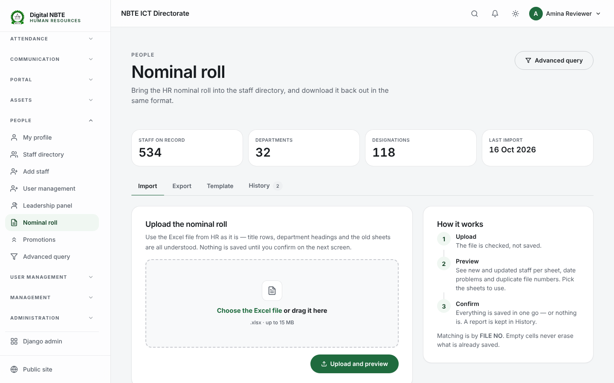 | 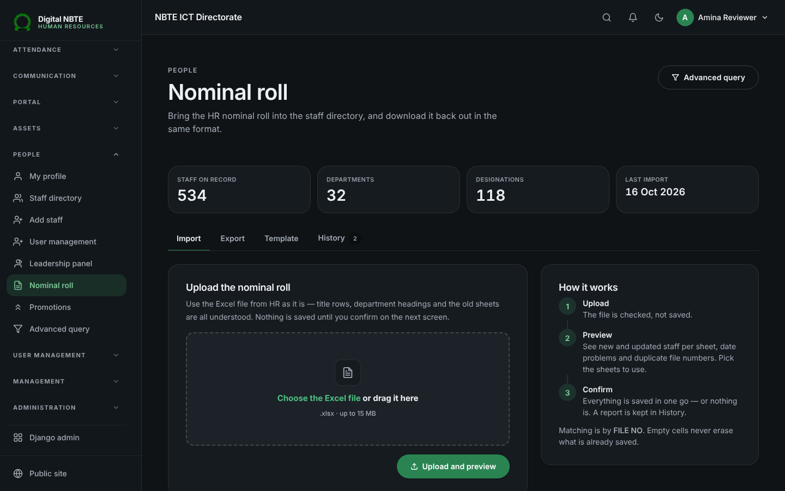 | 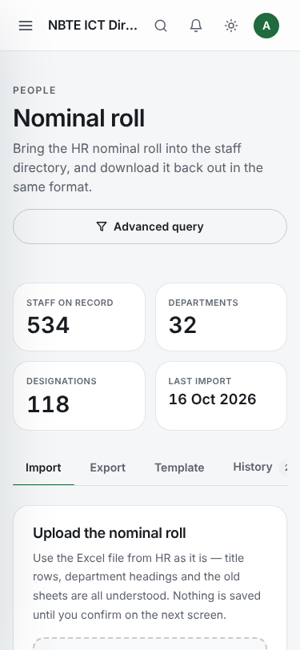 | 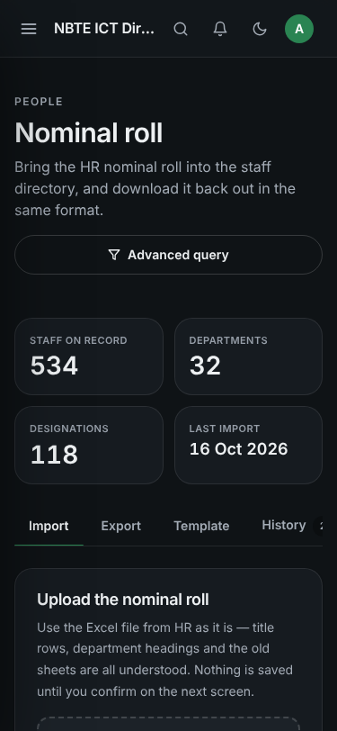 |
| Promotions | 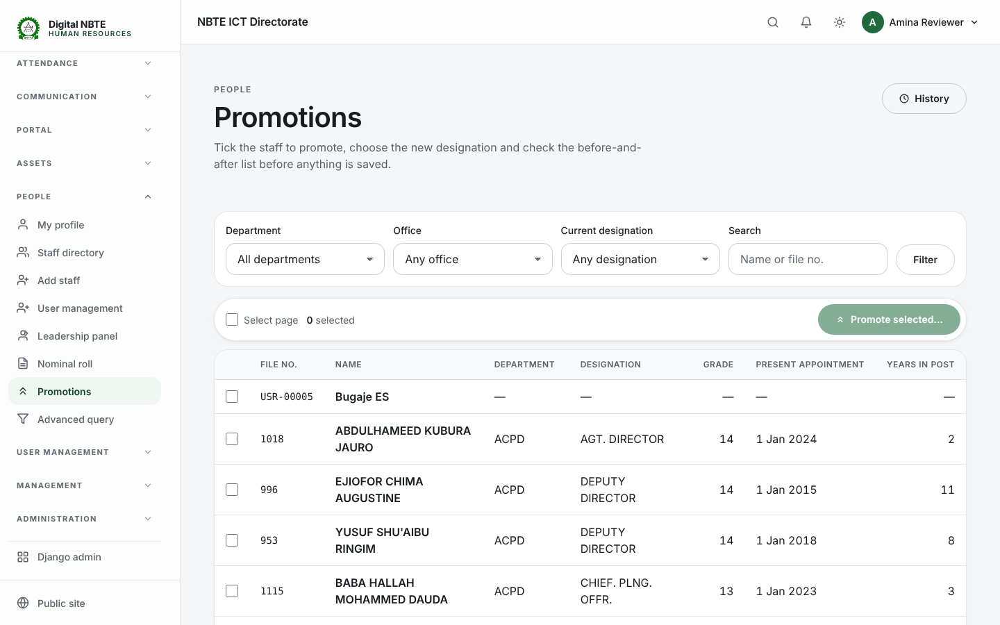 | 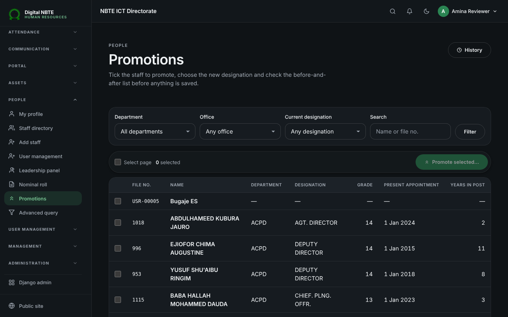 | 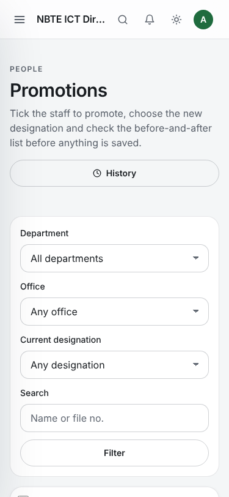 | 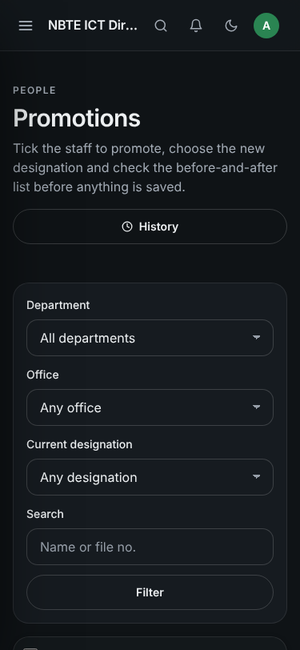 |
| Promotion history | 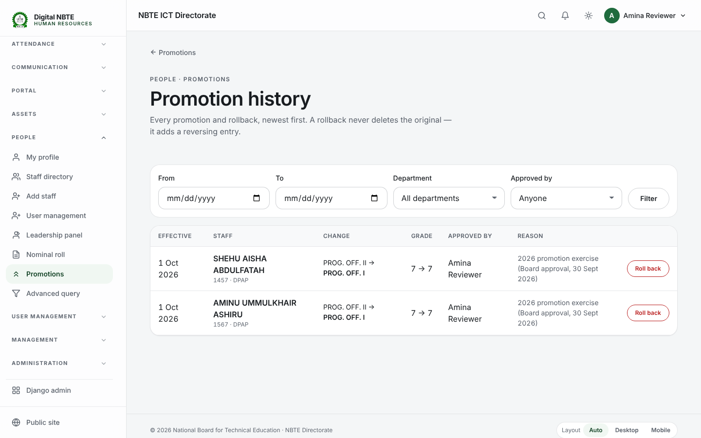 | 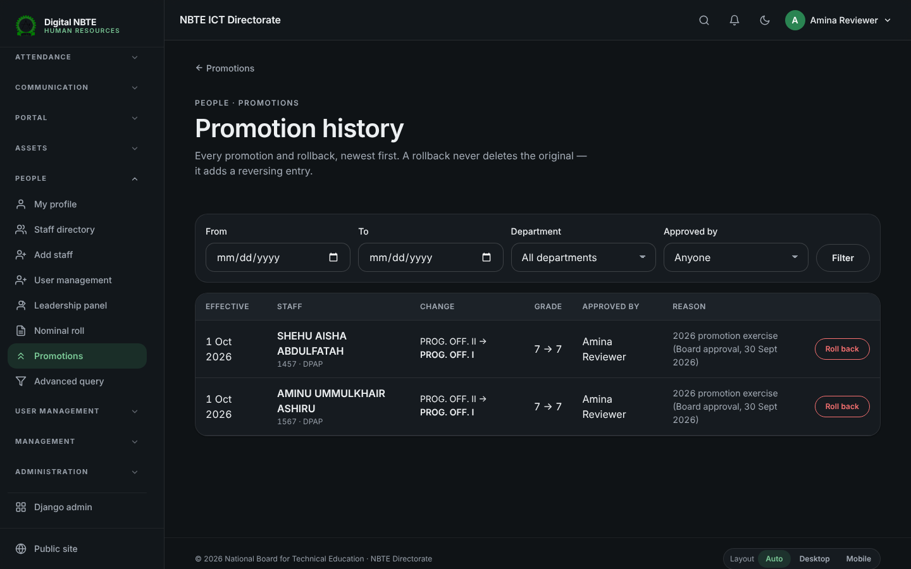 | 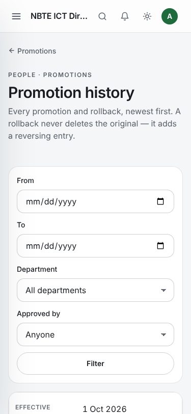 | 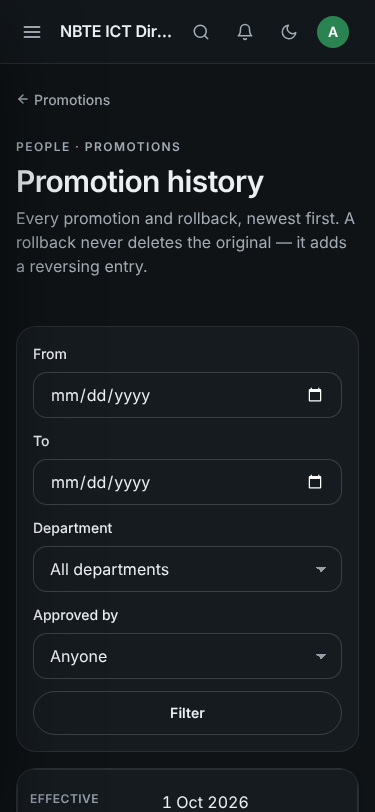 |
| Advanced query | 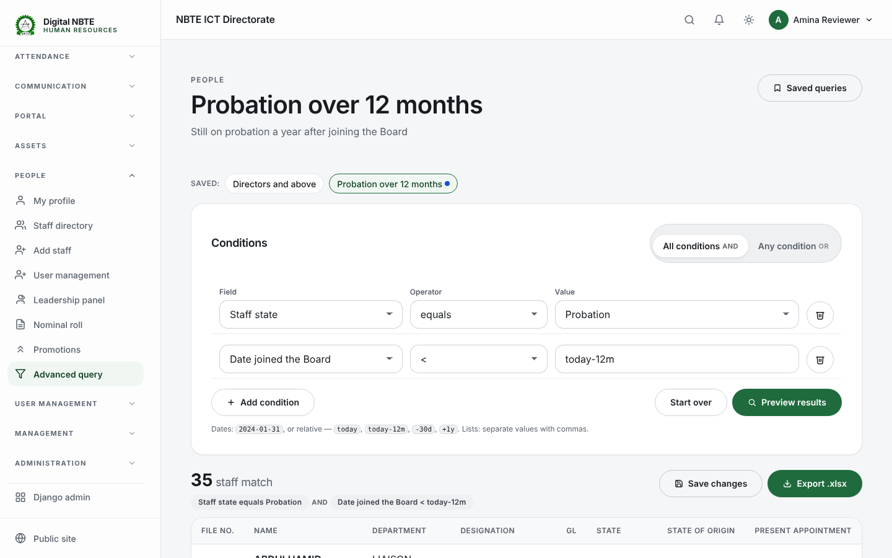 | 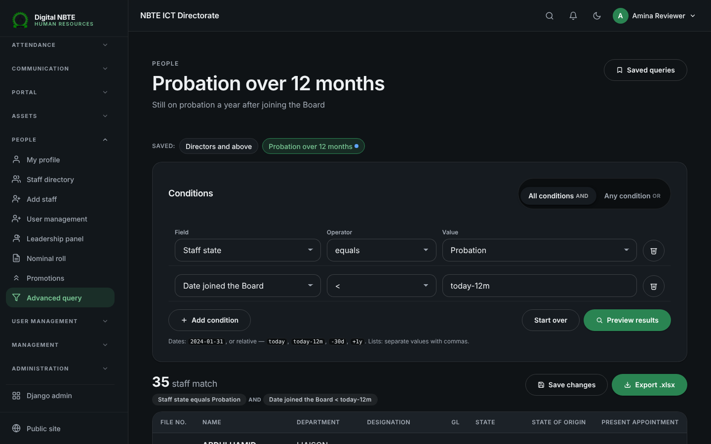 | 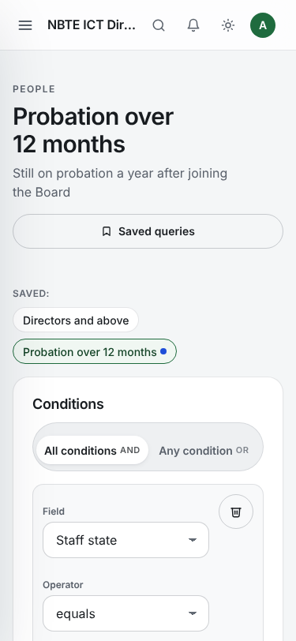 | 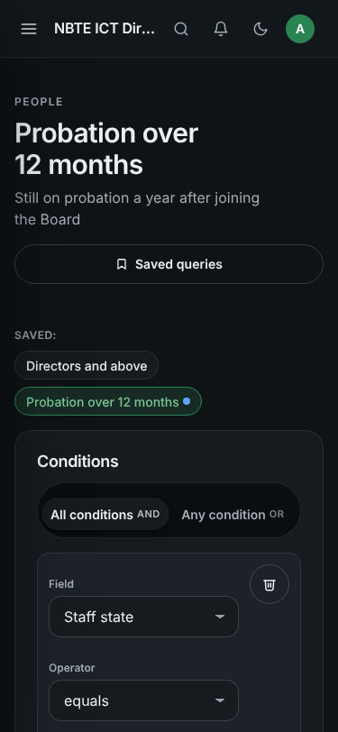 |

Also: `import-preview-1440-light.png` (full preview page), `promotion-dialog-1440-light.png`,
`promotion-dialog-375-dark.png`.

## 8. Seed heuristics (`seed_nbte`)

Ranks: Executive Secretary 100 · Director / Acting Director 90 · Deputy Director 80 · Chief /
Head 70 · Assistant Chief / Assistant Director 65 · Principal 60 (+1 for grade I) · Senior 57 (+1) ·
Higher 55 (+1) · Officer I/II/III 40/35/30 · Executive Officer 25 · Clerical 20 · Assistant 15 ·
trades (driver, mechanic, foreman, fireman, artisan) 10–20 · anything else 0.

Deviations from the brief, on purpose: (a) the brief's “Assistant / Clerical / Executive Officer:
25 / 20 / 15” is applied as Executive Officer 25, Clerical 20, Assistant 15 — that is the CONTEDISS
order in the file; (b) junior-cadre posts whose CONTEDISS tops out at 6 (e.g. CHIEF CLERICAL OFF.)
are squeezed into the 10–24 band so a “Chief” clerk never outranks a Senior Programme Officer;
(c) a bare “X OFFICER” with no numeral is entry grade (30).

Ladder: within a family (title with SENIOR/CHIEF/PRINCIPAL/ASSISTANT/HIGHER/ACTING/DEPUTY and the
numeral removed) the next step is the lowest strictly higher rank; at the top of a family, the
next higher rank overall (a substantive post before an Acting one). The full table is in
`SETUP.md` and printed by `seed_nbte`.

## 9. Changes outside `staff/` (and why)

* `core/search.py`, `messaging/memos_views.py`, `messaging/memo_documents.py` — one line each:
  they searched/printed `designation` as text; with the foreign key they use `designation__name` /
  `str(designation)`. Without this the global search and memo letterheads would break.
* `core/test_files.py`, `staff/tests.py`, `staff/test_fix_h7.py` — three test lines assigned or
  compared `designation` as a string; they now use a Designation (behaviour checked is unchanged).
* `templates/partials/sidebar.html` — the three links (the sidebar lives here, not in base.html).
* `README.md` (one pointer to SETUP.md), `SETUP.md`, these documents, `docs/nominal-roll/`.
EOF
echo ok

---

## 10. Follow-up: one staff import/export, sign-in accounts, the staff file

### One staff import/export
* The wizard's **Staff** module (Administration → Import / Export) opens Staff import & export;
  its template/export links go to the nominal-roll template/export. The old column layout
  (`staff.imports.StaffImport`) is kept for code that calls it, but is no longer offered.
* The nominal roll accepts three optional extra columns after the 17 official ones —
  **EMAIL, PHONE, OFFICE** — and the export and template include them.
* **Merging, not duplicating.** A person already in the system as an account record (`USR-…`,
  made when a user account was added) is matched by surname + a shared other name (or by EMAIL) and
  takes the file number and nominal-roll details. The preview lists every merge. An account's own
  email is never overwritten by the import.

### Sign-in accounts (preview option; needs `accounts.add_user`)
* “Create a sign-in account for everyone in this import who doesn't have one.”
* **The email is the username.** Staff with an email in the file (or on their record) sign in with
  it, receive a **welcome email** with their temporary password (category *credentials*, so the body
  is not stored in the email log), and can reset a forgotten password. Staff with no email yet sign
  in with their **file number**; as soon as an email is added to their record (edit form, admin or a
  later import) it becomes their sign-in automatically. They can change their email on their profile.
* Temporary password: **surname + file number** (`jabir1413`), **one starter password** (≥ 8
  characters), or **random** (a one-time downloadable sheet on the History tab, deleted after it is
  downloaded). Everyone must change it at first sign-in (`must_change_password`). New accounts get
  the *Staff* role and the person's department.
* Speed: temporary passwords are hashed with fewer PBKDF2 rounds (20 000) so ~500 accounts take a
  few seconds; Django re-hashes with the full count at first sign-in.
* Sign-in form: “Email or file number” (`accounts.backends.RolePermissionBackend.authenticate`).

### Staff file (staff detail page)
One timeline, newest first, with filters (Career · Items · Messages · Record): record created,
sign-in account created, nominal-roll imports, state changes, promotions and rollbacks,
**transfers**, items **given and returned** (assets assigned to the person's account), and
messages / notifications sent from the page (subject and a short preview). **Items held now** lists
assets currently assigned. Visible to HR-level viewers, promoters and transfer officers.

**Transfers:** new `StaffTransfer` model and **Transfer** button (permission
`staff.transfer_staff`): new department / zonal office and/or office, effective date, required
reason, optional in-app notice. Moves made any other way (edit form, admin, import) are recorded
automatically by `Staff.save()`; a first posting (nothing → something) is not counted as a transfer.

Screenshots: `staff-file-1440-light.png`, `staff-file-375-dark.png` (and the other two variants),
`staff-import-export-*.png`, `import-export-admin-*.png`.

### Email
Outgoing mail goes through `notifications.engine`: Brevo SMTP relay → Brevo HTTP API → Gmail, with
daily quotas, retries and an email log. New: **`python manage.py check_email [--send --to …]`**
checks the sender address, each provider's DNS, connection, STARTTLS and login, the delivery mode
(Celery), and can send a real test message. See `SETUP.md` → *Email*.
